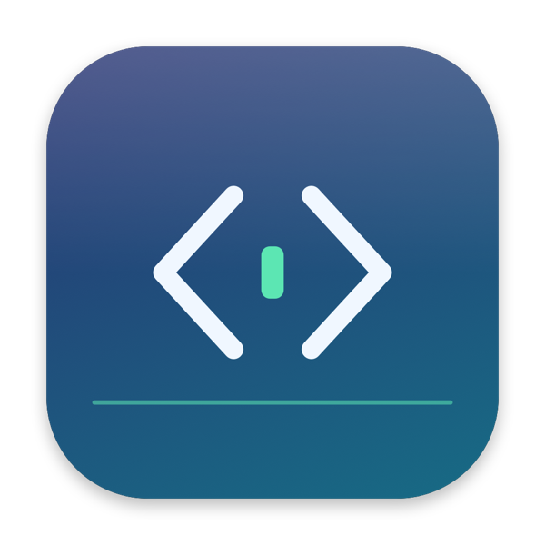
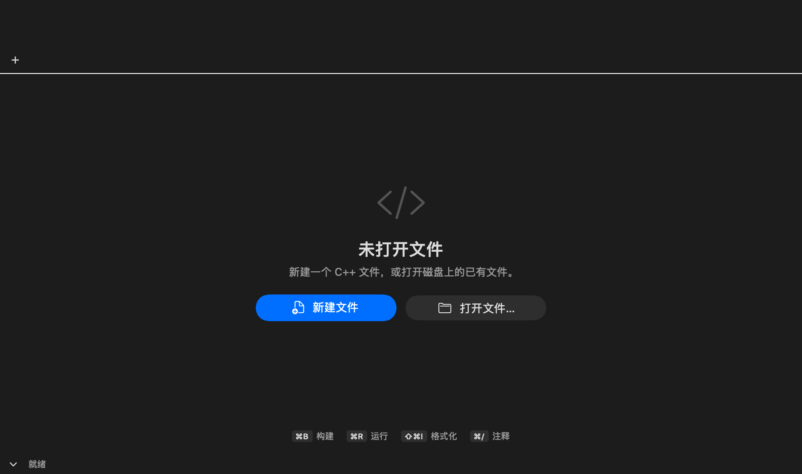
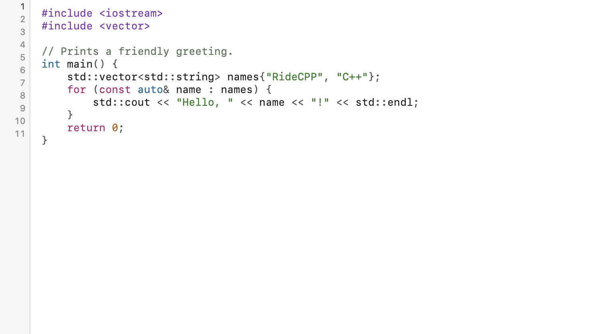
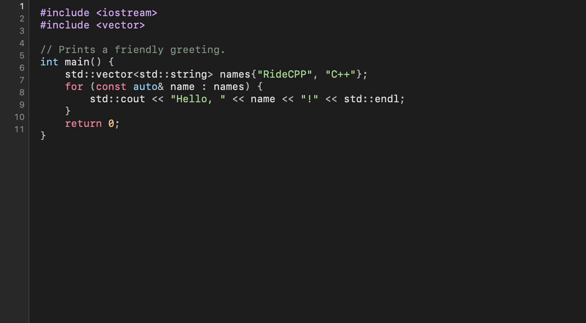

# RideCPP

一个轻量的 macOS 原生 C++ IDE。界面用 **SwiftUI**，编辑内核用 **AppKit `NSTextView`**，直接调用本机的 `clang++`/`g++` 编译运行，不依赖终端。

A lightweight native macOS C++ IDE: **SwiftUI** for the interface, **AppKit `NSTextView`** for the editor core, compiling and running through the local `clang++`/`g++` — no terminal required.

---

## 功能 / Features

| 能力 | 说明 |
|---|---|
| 多标签编辑 | 每个标签独立的光标位置、滚动位置与撤销栈 |
| 语法高亮 | C++ 词法着色（关键字、类型、数字、字符串、字符、注释、预处理命令）；明暗外观自适应 |
| 行号 | 独立 gutter，当前行高亮，宽度随行数自动调整 |
| 自动缩进 | 回车继承缩进；`{` 后自动加一级；`{|}` 回车展开为三行；`}` 自动回退一级 |
| 括号/引号自动配对 | `( [ { " '` 成对插入、选区包裹、闭合符 type-through、空对成对删除；字符串/注释内不配对 |
| 注释切换 | `⌘/` 对行或选区整行加/去 `//`，保持缩进对齐 |
| 格式化 | `⇧⌘I` 调用 `clang-format`，可用 LLVM / Google / WebKit 等风格或项目里的 `.clang-format` |
| 编译运行 | `⌘B` 编译当前文件，`⌘R` 编译并运行；`⌘.` 停止。默认 `-O2` |
| 构建前自动保存 | 编译/运行前先保存到磁盘；未命名文件会先要求选一个保存位置 |
| 代码补全 | 输入即弹出候选（`c` → `cin`、`cout`、`cerr`…），`↑`/`↓` 选择，`⏎` 接受，`Esc` 关闭，`⌃Space` 手动触发 |
| 常用预测 | 候选按使用频率排序，常用名在首字母时就出现，不用把词打全 |
| 符号记忆 | 你写过的函数、结构体、类、变量名会记住，换个文件依然能补全 |
| 候选图标 | 每项前面一个方框角标：`kw` 关键字、`fx` 头文件/函数、`var` 变量 |
| 运行统计 | 程序结束会显示退出码、运行用时（不含等待输入）与峰值内存（如 `退出码 0 · 用时 12 ms · 内存 3.4 MB`） |
| 交互式运行 | 程序跑在伪终端里：提示语随打印即时出现，运行中可随时输入（也可先排队、运行时自动送入） |
| 终端框 | 输出与输入在同一个框里：直接在里面打字、回车发送，就像终端；`Ctrl-C` 中断 |
| 实时输出 | 只显示程序自己的输出，不夹编译日志 |
| 问题列表 | 编译器诊断解析为可点击条目，点击跳转到对应行列并标出该行 |
| 输入 | 在终端框里直接输入，回车发送；未运行时输入则排队，程序启动后自动送入 |
| 设置 | 编译器路径、C++ 标准（默认 C++17）、优化级别、额外编译参数、运行参数、缩进、字号、clang-format 风格 |
| 双语界面 | 中文 / English 跟随系统语言 |
| 欢迎页 | 没有打开文件时给出「新建文件 / 打开文件」入口与最近打开列表，而不是空白文档 |
| 标签页 | 关闭最后一个标签后回到欢迎页；「未命名 N」的编号会自动复用（关掉 1 号，下一个新文件又叫 1 号）；未保存的标签实时显示圆点 |
| 应用图标 | 代码绘制（`scripts/AppIconRenderer.swift` 生成全套尺寸），`make icon` 可重新生成 |
| 代码补全 | **本期不实现**，已预留 `CompletionProviding` 协议与调用点，后续接模型无需改编辑器结构 |









---

## 下载 / Download

从 [Releases](https://github.com/JiangWanZhengChouYv/RideCPP/releases) 下载最新的 `.dmg`，打开后把 RideCPP 拖进「应用程序」。

**首次打开**：本版本为 ad-hoc 签名、未经 Apple 公证，macOS 会拦一次。请在「系统设置 → 隐私与安全性」点「仍要打开」，或执行：

```bash
xattr -d com.apple.quarantine /Applications/RideCPP.app
```

需要 Xcode Command Line Tools（提供 `clang++`）：`xcode-select --install`。

## 更新 / Updates

应用启动时会在后台检查 GitHub 上的新版本，有更新时在底部显示提示条；也可以随时用「RideCPP → 检查更新…」手动检查。点击下载会打开 Release 页面。

版本号规则：`主.次.修订 (构建号)`，例如 `1.0.0 (1)`。同一个版本号下的构建号递增也算更新。

发布新版本：

```bash
# 打 tag（同时包含版本和构建号），GitHub Actions 自动构建并发布
git tag "v1.0.1(1)" && git push origin "v1.0.1(1)"
```

或在本机直接发布（需要 `gh auth login`）。脚本会先把版本号写进 `project.yml`：

```bash
scripts/release.sh 1.0.1 1
```

## 快速开始 / Getting started

要求：macOS 14+、Xcode 26+（含命令行工具）、[XcodeGen](https://github.com/yonaskolb/XcodeGen)（`brew install xcodegen`）。

```bash
make generate   # 由 project.yml 生成 RideCPP.xcodeproj
make build      # 构建，产物在 build/Build/Products/Debug/RideCPP.app
make run        # 构建并启动
make install    # 安装到 /Applications 并启动（替换旧版本）
make dist       # 构建 Release 通用版并打包 dist/RideCPP-*.dmg
make test       # 运行单元测试
make selftest   # 驱动真实 app 做端到端验收检查
make verify     # 构建 + 单元测试 + 端到端检查 + 工具链冒烟测试
```

`make build` 后可直接双击 `build/Build/Products/Debug/RideCPP.app`，
或 `make install` 装进 `/Applications`（推荐，从启动台/Dock 正常使用）。

安装时会把构建目录里的副本从 LaunchServices 注销，保证系统里只有一份 RideCPP，
Dock 与启动台不会出现重复图标。

---

## 常用快捷键 / Shortcuts

| 快捷键 | 动作 |
|---|---|
| `⌘T` | 新建标签页 |
| `⌘O` | 打开文件（可多选） |
| `⌘S` / `⇧⌘S` | 保存 / 另存为 |
| `⌘W` | 关闭标签页 |
| `⌘Z` / `⇧⌘Z` | 撤销 / 重做（按标签页隔离） |
| `⌘B` | 构建当前文件 |
| `⌘R` | 构建并运行 |
| `⌘.` | 停止构建或运行 |
| `⌘/` | 注释 / 取消注释 |
| `⌘]` / `⌘[` | 增加 / 减少缩进 |
| `⇧⌘I` | 格式化文档（clang-format） |
| `Enter`（终端框内） | 把输入的那一行发送给程序 |
| `Ctrl-C`（终端框内） | 中断正在运行的程序 |
| `⌘F` | 在文件中查找（系统查找条） |
| `⇧⌘Y` | 显示 / 隐藏输出面板 |

---

## 设置 / Settings

`RideCPP → 设置…`（`⌘,`），分四页：

- **编辑器**：字号、缩进宽度、制表符缩进、自动配对、自动缩进、显示行号。
- **构建与运行**：编译器（自动发现 `/usr/bin/clang++`、Homebrew 的 `g++-NN` 等，也可手动选路径）、C++ 标准（默认 `c++17`）、优化级别、额外编译参数（如 `-Wall -Wextra -Iinclude`）、运行参数。
- **格式化**：clang-format 路径与风格（`LLVM`/`Google`/`Chromium`/`Mozilla`/`WebKit`/`Microsoft`/`file`）。
- **通用**：恢复默认值；界面语言跟随系统。

设置保存在 `UserDefaults`。

---

## 编译范围 / Build scope

**当前文件**：`⌘B`/`⌘R` 只把活动标签页翻译成一个可执行文件。

- 已保存的文件：在文件所在目录编译，产物写入系统临时目录。
- 未保存的标签页：内容先写入 scratch 文件（`~/Library/Application Support/RideCPP/Scratch/<tab-id>/`，若该位置不可写则退回临时目录）再编译，因此诊断仍能映射回该标签页。

多文件工程的整体构建不在本期范围；`BuildService` 的接口（`BuildRequest.sourcePath`）已为多源文件集合留出扩展位置。

---

## 运行与输入 / Running and input

程序通过**伪终端（PTY）**运行，所以行为和终端里一致：

- 程序 `std::cout << "Name? ";` 没有换行、也没有 `flush`，输出依然**立即**出现，不需要等到结束。
- **输出和输入在同一个终端框里**：程序打印的内容就在框里，直接接着打字、回车即送达 `std::cin`，不用切到别的控件。
- 框里已输出过的部分是锁定的：打字和删除都只作用于当前这一行，不会改到历史输出。
- 也可以在**运行前**先输入几行，它们会排队，`⌘R` 启动后自动依次送入（类似终端里的提前输入）。
- 终端回显是关闭的，输入由 IDE 自己回显在框里，不会重复。
- 终端框只显示程序自己的输入输出，编译器的命令行与错误文本只进入「问题」列表和状态栏。
- 补全词表不是手写的：关键字由当前编译器验证（一次编译，结果缓存到磁盘），类型与函数名**按需**从当前文件 `#include` 的头文件里索引。启动时不扫描任何头文件；用 `bits/stdc++.h` 也只是索引那一个头文件（约 0.35 秒，3000+ 个名字），查询为 0 毫秒。
- `↑`/`↓` 选择，`⏎`/`Tab` 接受，`Esc` 关闭；灰色的是占位符，接受时不会被填入，多行片段会按文档自身的缩进宽度对齐。
- 每项前面的小方框角标标明来源：`kw` = 语言关键字，`fx` = 头文件里的名字（含函数、类型），`var` = 你自己声明的变量/结构体/类/函数。角标在单词前面。
- 符号记忆只存你**自己写**的名字（函数、结构体、类、变量），不存关键字和标准库名，所以体积很小（单文件 JSON，上限 2000 条）。
- 候选按「常用度」排序：文件里已用过的名字最优先，其次是 include 的头文件里的名字，最后才是关键字。所以打 `c` 就能看到 `cin`/`cout`/`cerr`，打 `s` 会先给 `size`/`sort`/`swap`，而不是让一长串关键字把列表挤满。
- 检测 `using namespace std;`：有这行时提示 `vector<int>`，没有时提示 `std::vector<int>`。
- 程序退出时会给出实际耗时与峰值内存。这两个数字只统计程序本身：编译器不会被算进去。
- **耗时是运行用时，不含等待输入的时间**。交互程序停下来等 `cin` 时，那段时间不计入；纯计算程序（算法题常见情况）的数值就是真实运行时间，例如固定跑 1.2 秒的计算程序报 1201 ms。
- 内存来自内核 `wait4` 的峰值常驻集（RSS），即程序运行期间占用的最大内存。
- 框内 `Ctrl-C` 中断程序。

## 关于代码补全 / About completion

本期**不提供**任何补全 UI 或模型调用。预留的结构：

```swift
// Sources/EditorCore/CompletionProvider.swift
public protocol CompletionProviding: AnyObject {
    func completionItems(forPrefix prefix: String, document: String) -> [CompletionItem]
    func completions(forPrefix prefix: String, document: String) async -> [CompletionItem] // 远程模型用
}
```

调用点已经就位：`CodeTextView.completions(forPartialWordRange:indexOfSelectedItem:)` 会先问 `completionProvider`，为空时回退到 AppKit 默认行为。接模型时只需实现该协议并赋值给 `textView.completionProvider`。

---

## 分发 / Distribution

**当前状态：可以直接在本机使用，但不能直接发给别人。**

本机构建使用 ad-hoc 签名、未做公证，`spctl` 判定为 `rejected`。放到别的 Mac 上会被 Gatekeeper 拦截，对方需要在「系统设置 → 隐私与安全性」点「仍要打开」，或执行：

```bash
xattr -d com.apple.quarantine /Applications/RideCPP.app
```

要真正做到"下载即可打开"，需要 Apple 开发者账号 + 公证：

1. 加入 [Apple Developer Program](https://developer.apple.com/programs/)，在 Xcode → Settings → Accounts → Manage Certificates 创建 **Developer ID Application** 证书；
2. `make dist` —— 构建 Release 通用二进制（Apple 芯片 + Intel），有证书时自动用 Developer ID 签名（含 hardened runtime），无证书时退回 ad-hoc 并在输出中明确提示；
3. 设置公证凭据后 `make notarize`：
   ```bash
   xcrun notarytool store-credentials ridecpp \
       --apple-id you@example.com --team-id TEAMID --password <专用密码>
   NOTARY_PROFILE=ridecpp make notarize
   ```
   脚本会提交公证、staple 票据并校验。

产物在 `dist/RideCPP-<版本>-<架构>.dmg`（内含 App、Applications 快捷方式和一份安装说明）。

**为什么不走 Mac App Store**：RideCPP 需要调用本机的 `clang++`/`g++` 并运行生成的可执行文件，App Store 要求的 App Sandbox 会阻断子进程，所以只能通过网站/DMG 直接分发（签名 + 公证是唯一正规路径）。

## 工程结构 / Layout

```
project.yml              XcodeGen 工程描述（EditorCore / BuildKit / RideCPP + 2 个测试 target）
Makefile                 generate / build / run / test / selftest / verify / clean
Resources/*.lproj/       中英文界面字符串
Sources/
  EditorCore/            纯 AppKit 编辑内核（framework）
    CodeTextView         智能编辑、按文档的 UndoManager、诊断行标记
    EditPlanner          纯函数：配对/缩进/注释/删除规则（可单测）
    CppLexer             单趟 C++ 词法分析，输出 UTF-16 范围
    SyntaxHighlighter    用 layoutManager 临时属性上色（不污染 undo）
    LineNumberRuler      NSRulerView 行号 gutter
    EditorEngine         一个标签页的视图装配与生命周期
    TextCoordinates      行列 ↔ UTF-16 偏移
    CompletionProvider   补全协议 + 空实现（预留）
  BuildKit/              进程与工具链（framework）
    Toolchain            编译器 / clang-format 发现与版本识别
    ProcessRunner        编译器进程：Pipe 流式输出、可取消
    InteractiveProcess   程序进程：PTY 会话、实时输出、运行中输入、Ctrl-C
    BuildService         编译、启动交互运行、超时与取消
    DiagnosticsParser    clang/gcc 诊断解析
    FormatterService     clang-format 集成
  RideCPP/               SwiftUI 应用
    RideCPPApp           @main、窗口、菜单、AppDelegate
    AppState             标签页、输出、诊断、构建会话
    DocumentModel        标签页 = 编辑引擎 + 撤销栈 + 文件状态
    ContentView / TabStrip / OutputPanel / SettingsView / EditorHost
    ConsoleView          终端框：输出与输入合一的 NSTextView
    SelfTest             `RIDECPP_SELFTEST` 下的端到端验收检查
Tests/                   66 个 EditorCore 测试 + 34 个 BuildKit 测试
scripts/smoke.sh         真实「编译 + 运行 + 诊断 + 格式化」冒烟检查
scripts/AppIconRenderer.swift  应用图标绘制（make icon）
scripts/release.sh       本机发布新版本到 GitHub
.github/workflows/release.yml  打 tag 后自动构建并发布
```

---

## 设计要点 / Design notes

- **每个标签页一个 `EditorEngine`**：切换标签天然保留光标、滚动与撤销历史，不需要手动存取状态。
- **高亮走临时属性**：`NSLayoutManager.addTemporaryAttribute` 只影响绘制，不写入文本存储，所以撤销栈里只有用户的真实编辑。
- **编辑规则是纯函数**：`EditPlanner` 只处理 `String` + `NSRange`，因此全部规则都能在没有 AppKit 的情况下单元测试。
- **TextKit 1**：编辑器使用 `NSTextView(frame:textContainer:)` 并显式装配 `NSTextStorage`/`NSLayoutManager`/`NSTextContainer`；临时属性高亮与 `NSRulerView` 行号在这条路径上最稳定。
- **改动最小化**：一次编辑只替换真正变化的片段（公共前后缀之外的区间），布局与撤销记录都更小。

---

## 已知限制 / Known limitations

- 编译范围是当前文件，不支持一次编译多个源文件或链接库（可通过「额外编译参数」手动补充 `-l` 等）。
- 没有调试器、重构、符号跳转或项目管理。
- 代码补全未实现（见上文）。
- 关闭最后一个标签会回到欢迎页，不会自动新建一个替代文档。
- 关闭 Sandbox、使用 ad-hoc 签名：本地 IDE 需要派生编译器与运行子进程，这是能运行的前提；上架分发不在本期范围。
- 超大文件（>2 MB）只高亮可见区域，>12 MB 不再高亮。

---

## 构建环境说明 / Build environment note

本机 Swift 驱动的宏插件服务在默认沙箱下无法启动（`sandbox-exec: sandbox_apply: Operation not permitted`），会让 `@State`/`@Observable` 编译失败。因此 `project.yml` 全局设置了：

```
OTHER_SWIFT_FLAGS = $(inherited) -Xfrontend -disable-sandbox
```

同时 `Makefile` 把 `CLANG_MODULE_CACHE_PATH` / `SWIFT_MODULE_CACHE_PATH` 指向 `build/ModuleCache`，因为本机 `$TMPDIR` 下的默认缓存位置不可写。

`xcodebuild test` 在本机会因 "Pseudo Terminal Setup Error" 失败，所以 `make test` 改为 `build-for-testing` + `xcrun xctest` 直接执行测试 bundle。
